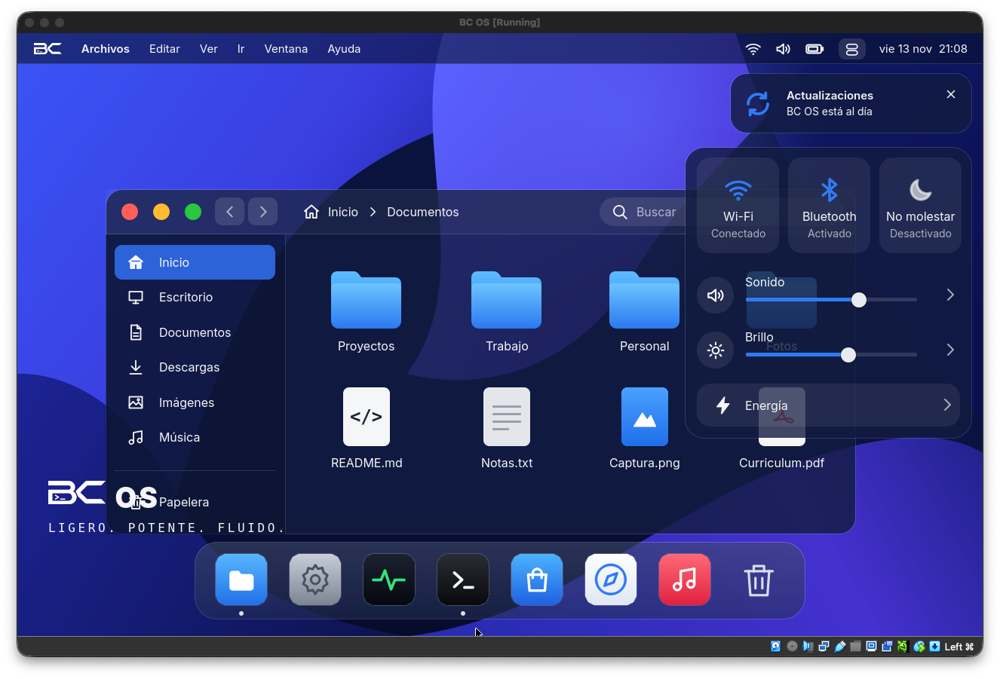
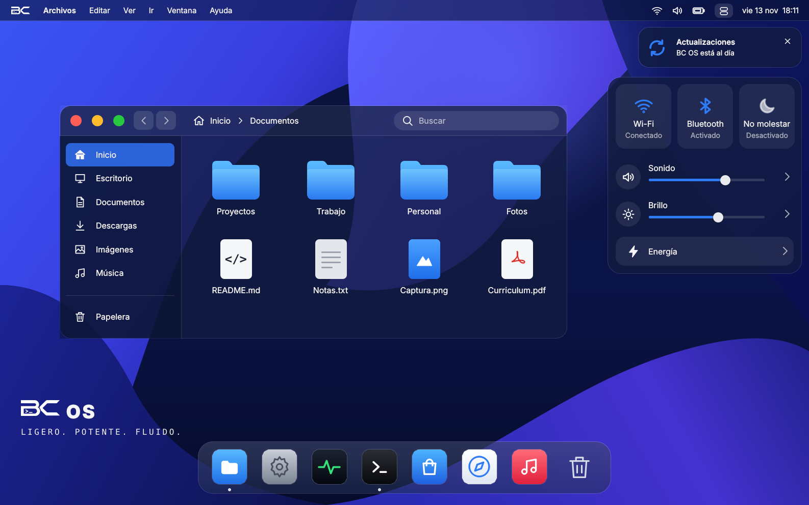
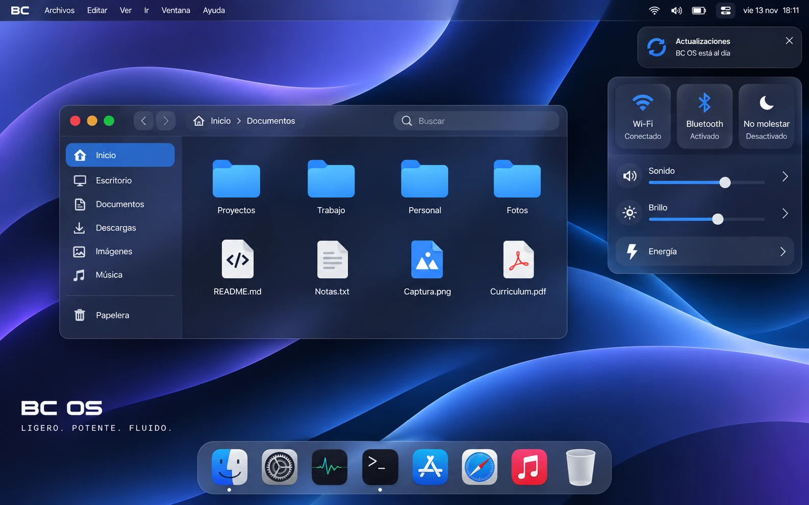
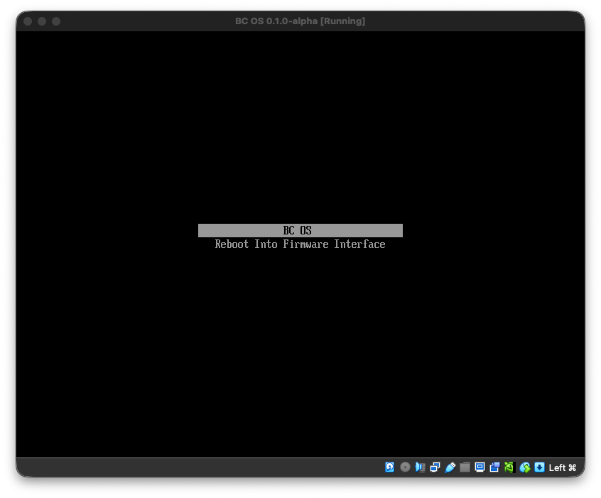

<p align="center">
  
</p>

<h1 align="center">BC OS</h1>

<p align="center"><b>LIGERO. POTENTE. FLUIDO.</b><br>
Sistema operativo Linux ARM64 creado por <b>Borja Candel</b>, en español por defecto.</p>

<p align="center">
  
  
  
  
  
</p>

<p align="center">
  
  <br><sub>Captura real (aportada por el creador): BC OS 0.1.2-alpha en VirtualBox ARM64, BC Shell sobre labwc (Wayland), render por software.</sub>
</p>

> **Estado honesto:** alpha muy temprana. Hay una imagen ARM64 que arranca y un shell que se ve así, pero **el shell aún es un prototipo visual** (Dock, Archivos y Centro de control no son funcionales), **no hay instalador ni ISO todavía** y la imagen **solo `0.1.2-alpha` ha arrancado en VirtualBox ARM64** (ver [problemas conocidos](#problemas-conocidos)).

---

## Descargar y probar

Última imagen: [**Releases**](https://github.com/borjacandeel/BC-OS/releases) (prerelease). Cada release incluye `BC-OS-<versión>-ARM64.vdi.zip` y `SHA256SUMS`.

1. Descomprime el `.zip` → `.vdi`. Comprueba `shasum -a 256`.
2. VirtualBox (Mac Apple Silicon) → **Nueva**: Linux / Arch Linux (ARM 64-bit), ≥ 2 GB RAM, 2 CPU.
3. **Sistema → Habilitar EFI**. Disco: usar el `.vdi` existente. Gráficos: VMSVGA.
4. Arranca. Sesión automática como `bc` (contraseña `bcos`, **solo alpha**).

También se prueba sin VirtualBox con QEMU (`qemu-system-aarch64 -M virt` + UEFI AAVMF); ver [`docs/development/BUILD.md`](docs/development/BUILD.md).

## Versiones

| Versión | Estado | Qué trae |
|---|---|---|
| `0.1.0-alpha` | publicada | Primera imagen ARM64: arranca en QEMU; en VirtualBox falla el `fsck` del root (ver abajo). |
| `0.1.1-alpha` | publicada | Mitigación del `fsck`; en VirtualBox arrancaba a pantalla negra (labwc sin 3D). |
| `0.1.2-alpha` | publicada | **Arranca en VirtualBox ARM64** con BC Shell (render por software) y SSH activado. El shell es una maqueta. |
| `0.2.0` | planificada | BC Shell funcional (Dock, lanzador, Centro de control). |
| `0.3.0` → `1.0.0` | planificadas | Apps nativas, instalador, beta y primera estable. Son hitos, no promesas. |

## Capturas

<table>
  <tr>
    <td width="50%"><br><sub><b>BC Shell</b> (prototipo QML, captura generada por el propio shell en pruebas).</sub></td>
    <td width="50%"><br><sub><b>Referencia visual</b> del creador: el objetivo de diseño, no una captura del sistema.</sub></td>
  </tr>
  <tr>
    <td><br><sub><b>Pack de iconos BC</b> (catálogo real, en construcción por lotes).</sub></td>
    <td><br><sub><b>VirtualBox ARM64</b>: menú de arranque de BC OS 0.1.0-alpha (systemd-boot).</sub></td>
  </tr>
</table>

## Problemas conocidos

- **VirtualBox:** `0.1.0` y `0.1.1` fallaban (`fsck` en 0.1.0; labwc sin EGL/3D en 0.1.1). `0.1.2-alpha` lo resuelve con render por software.
- **BC Shell es una maqueta:** casi nada responde todavía; los botones, el Dock y el Centro de control no hacen nada real. Es la siguiente prioridad.
- El layout del shell está diseñado para 1586×992 y se solapa en pantallas menores.
- Sin instalador ni ISO. Contraseña por defecto pública (solo alpha).
- Rendimiento no medido; los objetivos de abajo son metas, no resultados.

---

## Qué es BC OS

Un Linux ARM64 **ligero, fluido y en español**, con un escritorio propio (**BC Shell**) de estética minimal inspirada en macOS pero con identidad original (logos en [`assets/branding/`](assets/branding/)). No usa código, marcas ni recursos de Apple.

| Pieza | Elección |
|---|---|
| Base | Arch Linux ARM (aarch64), kernel Linux estándar, systemd, pacman |
| Gráficos | Wayland · compositor **labwc** (wlroots) · Mesa; respaldo por software |
| Shell | **BC Shell**: Qt 6 / QML |
| Servicios | **BC Core**: Rust + D-Bus (`bc-daemon`, settings, update, security, hardware, performance) |
| Sistema | PipeWire · NetworkManager · zram · nftables · arranque UEFI con systemd-boot |
| Idioma | `es_ES` por defecto, inglés secundario (Qt Linguist) |
| Imagen | GPT: ESP FAT32 + ext4, construida en CI ARM64 nativo |

Decisiones y motivos: [`ARCHITECTURE.md`](ARCHITECTURE.md) y [`docs/adr/`](docs/adr/).

## Estado por componente

| Componente | Estado |
|---|---|
| Imagen ARM64 (arranque UEFI, sesión gráfica automática) | ✅ arranca en QEMU y en VirtualBox ARM64 (0.1.2) |
| BC Shell (barra, Dock, Archivos, Centro de control, notificación) | 🟡 prototipo visual, tests `ctest` 3/3 |
| BC Core (6 servicios D-Bus) | ✅ `fmt`, `clippy`, 23 tests; probado en bus de sesión |
| Pack de iconos | 🟡 lote A (UI, 102 iconos); lotes B (apps) y C (lugares/MIME/dispositivos) en curso |
| Instalador (`bc-install`) | 🟡 probado en QEMU (con y sin LUKS); en la imagen desde 0.1.3 |
| ISO con instalador | ⛔ pendiente |
| Benchmarks / optimización | ⛔ pendiente |

## Objetivos (a medir, no garantizados)

RAM en reposo ≤ 700 MB · CPU en reposo ≈ ≤ 2 % · 60 FPS (120 donde se pueda) · arranque rápido. Se medirán sobre una VM de referencia documentada antes de afirmar nada.

## Hoja de ruta

`0` Viabilidad ✅ → `1` Base ✅ (arranca) → `2` BC Shell 🟡 → `3` Identidad visual 🟡 → `4` Apps → `5` Integración → `6` Optimización → `7` Instalador → `8` Beta pública. Detalle en [`ROADMAP.md`](ROADMAP.md) y trabajo vivo en [`PENDIENTE.md`](PENDIENTE.md).

## Estructura del repositorio

```
assets/branding/    logos e iconos oficiales BC
build/              pipeline de imagen (build-all, mkimage, rootfs, overlay)
core/               BC Core (Rust)
shell/              BC Shell (Qt 6 / QML)
icons/              pack de iconos (SPEC, fuentes SVG, build, lint, catálogo)
docs/               diseño, desarrollo, ADRs, capturas
tools/              diagnóstico de host, utilidades
.github/workflows/  CI en runners ARM64 (ci.yml, image.yml)
```

## Construir

```bash
sudo build/build-all.sh 0.1.1-alpha      # imagen completa (host ARM64 o x86_64 con qemu-user)
```

En GitHub: **Actions → Imagen ARM64 → Run workflow** (opción *publicar* crea un prerelease). Guía completa: [`docs/development/BUILD.md`](docs/development/BUILD.md), pruebas: [`TESTING.md`](docs/development/TESTING.md), ARM64/VirtualBox: [`ARM64.md`](docs/development/ARM64.md).

## Principios

Español primero · solo ARM64 · nada de afirmar lo no probado · seguridad intacta · optimizar midiendo · builds reproducibles · sin credenciales en el repo. Normas en [`CONTRIBUTING.md`](CONTRIBUTING.md) y [`SECURITY.md`](SECURITY.md). Reglas para agentes: [`CLAUDE.md`](CLAUDE.md).

---

<p align="center">© Borja Candel · Licencia GPL-3.0-or-later con marca y logos reservados (ver <a href="LICENSE"><code>LICENSE</code></a>)</p>
