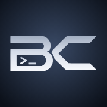

<p align="center"></p>

# BC OS

**LIGERO. POTENTE. FLUIDO.** — *Lightweight. Powerful. Fluid.*

Sistema operativo Linux creado por **Borja Candel**. ARM64 · Arch Linux ARM · Español por defecto · Ultraligero · Ultrafluido.

> Estado: **Fase 0/1 — viabilidad y base.** Aún no hay imagen publicada. Ver [`PENDIENTE.md`](PENDIENTE.md).

---

## 1. Misión

Un sistema operativo Linux excepcionalmente ligero y rápido, con la elegancia y fluidez de un escritorio moderno inspirado en macOS, pero con identidad visual propia (la del creador, ver `assets/branding/`).

BC OS combina: flexibilidad de Linux, consumo mínimo de recursos, escritorio acelerado por GPU, animaciones fluidas, identidad visual original, usabilidad, seguridad, estabilidad, distribución internacional y arquitectura mantenible.

Debe sentirse como un **sistema operativo completo**, no como una distribución Linux modificada, un tema ni una maqueta.

Prohibido usar código, marcas, iconos, fondos o recursos propietarios de Apple. Todos los recursos son originales de BC OS.

## 2. Idioma — requisito innegociable

**Todo el sistema está en español (es_ES) por defecto**: arranque, bienvenida, inicio de sesión, bloqueo, escritorio, barra superior, Dock, Archivos, Configuración, Centro de control, Notificaciones, lanzador, tienda, instalador, errores, diálogos, menús de energía, actualizaciones, red, sonido, pantalla, usuarios y documentación de usuario.

| Inglés | BC OS |
|---|---|
| Settings | Configuración |
| Finder / File Manager | Archivos / Gestor de archivos |
| Control Center | Centro de control |
| Notifications | Notificaciones |
| Display | Pantalla |
| Appearance | Apariencia |
| Network | Red |
| Sound | Sonido |
| Battery | Batería |
| Applications | Aplicaciones |
| System Monitor | Monitor del sistema |
| Software Updates | Actualizaciones |

- Idiomas iniciales: **español (España)** por defecto, **inglés** secundario.
- Identificadores de código en inglés; todo texto visible pasa por el sistema de localización compartido (Qt Linguist `.ts` / gettext).
- Preparado para nuevas traducciones sin reescribir aplicaciones. Unicode, distribuciones de teclado, formatos regionales, fechas, zonas horarias, alto contraste y movimiento reducido.

## 3. Identidad visual

Basada en los logos BC del creador (`assets/branding/`):

| Token | Valor | Uso |
|---|---|---|
| Azul noche | `#04111F` | fondo principal / logo sobre claro |
| Blanco BC | `#F5F5F7` | texto y logo sobre oscuro |
| Plata | `#F6F8FC → #D5DCE8 → #A1ADC0` | degradado del logo, acentos premium |
| Midnight | radial `#3A4A66 → #0B1019` | fondos, icono del sistema |

El sistema de diseño completo (paleta, tipografía, espaciado, radios, sombras, transparencias, iconos, componentes, animaciones, accesibilidad, ventanas, escritorio, apps) vivirá en [`docs/design/BC-DESIGN-SYSTEM.md`](docs/design/BC-DESIGN-SYSTEM.md) con tokens reutilizables. Un único lenguaje visual para todo el sistema.

## 4. Plataforma

- **Solo ARM64 (AArch64)** en la versión inicial. Arquitectura extensible a otras plataformas en el futuro.
- Host de desarrollo del creador: **Mac Apple Silicon**. Virtualización: **Oracle VirtualBox ARM64**.
- No se asume ninguna capacidad gráfica de VirtualBox sin probarla; limitaciones y alternativas documentadas en [`docs/development/ARM64.md`](docs/development/ARM64.md).
- Host, VM, distribución e imagen descargable se validan por separado.

## 5. Base del sistema

Arch Linux ARM (aarch64) · kernel Linux (sin kernel propio inicialmente) · systemd · Wayland · Mesa · PipeWire · NetworkManager · zram · arranque UEFI · pacman · paquetes base mínimos.

## 6. Tecnologías

| Lenguaje | Uso |
|---|---|
| **Rust** | servicios del sistema, hardware, actualizaciones, seguridad, monitorización, procesos en segundo plano |
| **C / C++** | integración de bajo nivel, gráficos, componentes críticos |
| **Qt 6 / QML** | BC Shell, Dock, lanzador, Configuración, Centro de control, notificaciones, apps nativas, animaciones |
| **Bash** | build, instalación, administración, automatización |
| **Python** | tests, análisis de benchmarks, utilidades |

Sin Electron en el núcleo. Tecnologías nativas y ligeras.

## 7. BC Shell — entorno de escritorio propio

- **BC Dock** — flotante inferior, magnificación, indicadores de apps abiertas, menús contextuales, minimizar al Dock, personalización, teclado.
- **BC Barra superior** — menú de app, reloj y fecha, red, audio, batería, indicadores, acceso al Centro de control.
- **BC Lanzador** — búsqueda, cuadrícula de apps, teclado, apertura instantánea.
- **BC Mission Control** — vista de ventanas, escritorios virtuales, previsualizaciones.
- **BC Centro de control** — Wi-Fi, Bluetooth, audio, brillo, pantalla, energía, ajustes rápidos.
- **BC Notificaciones** — centro, historial, No molestar.
- **BC Archivos** — cuadrícula/lista, barra lateral, ruta, búsqueda, operaciones, vista previa, atajos.
- **BC Configuración** — Pantalla, Apariencia, Red, Sonido, Energía, Teclado, Ratón, Usuarios, Seguridad, Actualizaciones.
- **BC Monitor** — CPU, RAM, GPU, temperatura, almacenamiento, procesos, red.
- **BC Terminal** — terminal nativo rápido, compatible con shells estándar.
- **BC Store** — gestión gráfica de software sobre pacman.

Componentes independientes: el fallo de una app opcional no tumba el escritorio.

## 8. Gráficos y animación

- Wayland obligatorio. Se reutiliza un compositor existente (KWin / wlroots / otro justificado); no se escribe un compositor propio antes de tener el shell funcionando.
- Aceleración GPU, frame pacing, VSync, escalado, multimonitor, 60 Hz y superiores, alternativas por software.
- Animaciones: abrir/cerrar/minimizar/maximizar ventanas, magnificación del Dock, Mission Control, escritorios, Centro de control, notificaciones, menús, popovers, navegación en Archivos. Curvas suaves, sin blur caro por CPU, carga diferida, modo de movimiento reducido.
- Objetivos (no garantías): 60 FPS en hardware capaz, 120 FPS donde se soporte, latencia mínima. Siempre medido antes de afirmarlo.

## 9. Rendimiento

Objetivos sobre una VM de referencia documentada: **RAM en reposo ≤ 700 MB**, **CPU en reposo ≈ ≤ 2 %**, pocos servicios, arranque rápido, poco disco. Scripts de benchmark automáticos (RAM, CPU, arranque, login, apertura de apps, FPS, frame time, disco, procesos, GPU). Sin sacrificar seguridad ni estabilidad.

## 10. BC Core (Rust)

`bc-daemon`, `bc-settings-service`, `bc-update-service`, `bc-security-service`, `bc-hardware-service`, `bc-performance-service`. D-Bus, mínimo privilegio, logs estructurados, IPC fiable, límites de módulo claros.

## 11. Seguridad

Permisos seguros, cortafuegos (nftables), verificación de firmas de paquetes, actualizaciones seguras, cifrado de disco opcional, separación de usuarios, servicios privilegiados mínimos, gestión segura de credenciales. Sin criptografía casera. Ver [`SECURITY.md`](SECURITY.md).

## 12. Paquetes y BC Store

Se mantiene pacman / repos de Arch Linux ARM. BC Store es una interfaz gráfica (buscar, explorar, instalar, eliminar, actualizar, info). Sin formato de paquete propio en la primera versión.

## 13. Instalación y distribución

Imagen ARM64 arrancable descargable desde **GitHub Releases** + SHA256 + notas + instrucciones + problemas conocidos. Instalador: usuario, locale español, teclado, zona horaria, red, particionado, cifrado opcional, primer arranque, marca BC OS. No se publica ninguna imagen sin probarla.

Versiones (hitos, no promesas): `0.1.0` base · `0.2.0` prototipo BC Shell · `0.3.0` componentes de escritorio · `0.4.0` apps nativas · `0.5.0` sistema integrado · `0.8.0` beta · `1.0.0` primera estable.

## 14. Hoja de ruta

| Fase | Contenido |
|---|---|
| 0 Viabilidad | repo, host, VirtualBox ARM64, Arch Linux ARM, gráficos, formato de imagen, decisiones |
| 1 Base | estructura, toolchain, sistema mínimo ARM64 arrancando en VirtualBox |
| 2 BC Shell | sesión gráfica, barra superior, Dock, lanzador, gestión de ventanas |
| 3 Identidad visual | design system, modo claro/oscuro, componentes, animaciones |
| 4 Aplicaciones | Archivos, Configuración, Monitor, Terminal, Store |
| 5 Integración | servicios, red, audio, hardware, seguridad, actualizaciones |
| 6 Optimización | benchmarks, perfilado, renderizado, distintas VMs |
| 7 Instalador | imagen ARM64, instalación, arranque, recuperación |
| 8 Beta pública | docs, Releases, checksums, instrucciones, beta testing |

Hitos técnicos: **(1)** sistema Linux ARM64 real arrancando en VirtualBox · **(2)** BC Shell funcionando en él · **(3)** imagen BC OS descargable y reproducible.

## 15. Reglas de desarrollo

Código mantenible, módulos pequeños, sin implementaciones falsas, nada sin probar, nada de hardware inventado, seguridad intacta, decisiones documentadas (`docs/adr/`), tests frecuentes, commits con sentido, español primero, solo ARM64, optimizar midiendo, builds reproducibles. Nunca credenciales en el repo. Sin force-push.

Reglas de trabajo de agentes en [`CLAUDE.md`](CLAUDE.md). Tareas en [`PENDIENTE.md`](PENDIENTE.md).

## 16. Estructura del repositorio

```
assets/branding/   logos e iconos oficiales BC
build/             pipeline de imagen ARM64 (paquetes, overlay, scripts)
core/              servicios BC Core (Rust)
shell/             BC Shell (Qt 6 / QML)
docs/              diseño, desarrollo, ADRs
tools/             utilidades (diagnóstico de host, benchmarks)
.github/workflows/ CI en runners ARM64
```

---

© Borja Candel. Licencia: ver [`LICENSE`](LICENSE) (pendiente).
