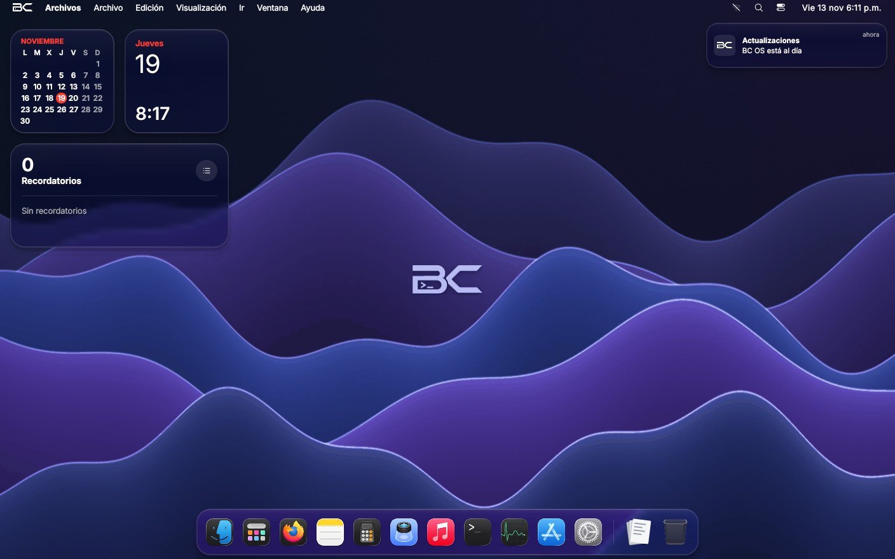
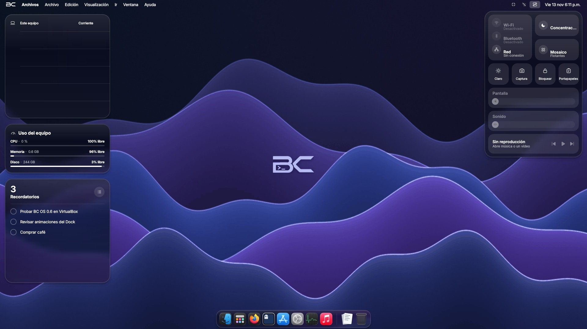
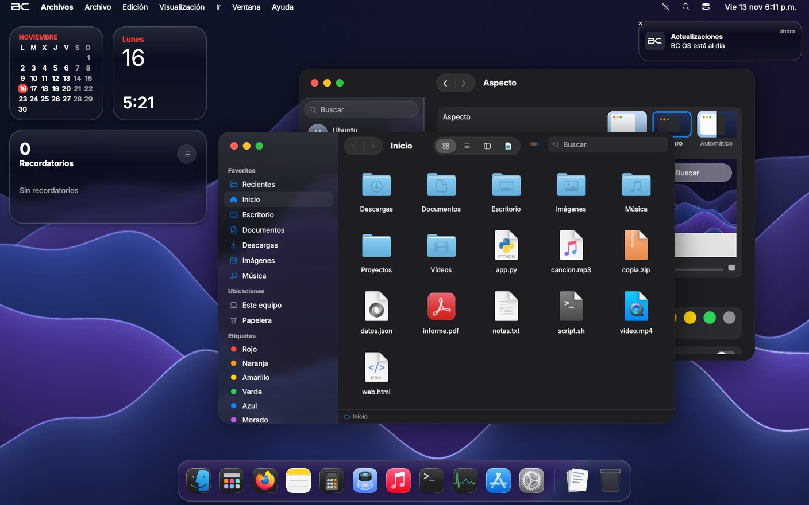

<p align="center">
  
</p>

<h1 align="center">BC OS</h1>

<p align="center"><b>LIGERO. POTENTE. FLUIDO.</b><br>
Sistema operativo Linux ARM64 creado por <b>Borja Candel</b>, en español por defecto.</p>

<p align="center">
  
  
  
  
  
</p>

BC OS es un Linux **ARM64** ligero y en español, basado en **Arch Linux ARM**, con compositor **sway** y un escritorio propio, **BC Shell** (Qt 6 / QML). Desde la serie 0.6 su escritorio por defecto es **«Golden Gate»**: una réplica del aspecto y del comportamiento de macOS 27 Golden Gate, hecha con código y recursos propios o libres (no usa recursos de Apple). Está pensado para probarse en máquinas virtuales ARM64 (VirtualBox en Mac Apple Silicon, QEMU).

<p align="center">
  
  <br><sub>Escritorio Golden Gate: barra de menús, widgets de vidrio, iconos en el escritorio, aviso y Dock. Captura del shell en el anfitrión de desarrollo.</sub>
</p>

> **Estado honesto:** beta experimental. La **0.6.0-beta** (Golden Gate) se ha construido y **arranca en QEMU aarch64 con login y escritorio correctos**, pero **todavía no está publicada** ni probada en VirtualBox; el creador decide cuándo se publica. Muchas piezas están compiladas y vistas en capturas, pero **pendientes de prueba real**. Ver [estado y pendientes](#estado-honesto-de-golden-gate).

---

## Escritorio Golden Gate

Qué incluye (detalle técnico y decisiones en [`docs/escritorio/ESTADO.md`](docs/escritorio/ESTADO.md)):

- **Barra de menús transparente**: logo BC, app activa en negrita, menús globales (Archivo, Edición, Visualización, Ventana, Ayuda), iconos de estado y reloj.
- **Widgets de vidrio** a la izquierda: baterías, uso del equipo (o widget de otra app) y recordatorios; arrastrables.
- **Dock de vidrio**: ampliación, punto de app abierta, rebote, apps **recientes**, **pila** de Descargas, **Papelera** (vacía/llena), minimizadas y ocultación automática.
- **Liquid Glass** con **deslizador** de intensidad (sin shaders; ver limitaciones).
- Modo **claro / oscuro** en caliente (shell, apps BC, GTK y sway).
- **Spotlight**: apps, archivos, cálculos y acciones.
- **Aplicaciones**: rejilla por páginas con búsqueda.
- **Mission Control** con escritorios («+», arrastrar ventanas entre escritorios) y **selector de apps**.
- Minimizar al Dock con **efecto genio**.
- **Control Center** (Wi-Fi, Bluetooth, red, Concentración, mosaico, aspecto, captura, bloqueo, portapapeles, brillo, sonido, reproducción) y **Centro de notificaciones** (historial y calendario).
- **Archivos** tipo Finder: barra lateral con Favoritos/Ubicaciones/Etiquetas, vistas de iconos/lista/columnas/galería, Vista rápida, etiquetas, pestañas y búsqueda.
- **Ajustes del Sistema** nuevos: Aspecto, Escritorio y Dock, Fondo, Notificaciones y los paneles anteriores.
- **Bloqueo e inicio de sesión** estilo Golden Gate.
- **Sonidos propios** (aviso, papelera, bloqueo, volumen, captura, error).
- Además: tema GTK MacTahoe para apps externas, fuente Inter, iconos MacOS-Like, cursor McMojave, terminal Ghostty (Alacritty si su compilación falla) y arranque con barra blanca.

### Capturas

<table>
  <tr>
    <td width="50%"><br><sub><b>Escritorio</b>: widgets de vidrio, iconos del escritorio, aviso y Dock.</sub></td>
    <td width="50%"><br><sub><b>Control Center</b>: Wi-Fi, Bluetooth, red, Concentración, mosaico, accesos rápidos, pantalla, sonido y reproducción.</sub></td>
  </tr>
  <tr>
    <td width="50%"><br><sub><b>Aplicaciones</b> (F4): rejilla con búsqueda sobre el fondo desenfocado.</sub></td>
    <td width="50%"><br><sub><b>Ventanas</b>: Archivos tipo Finder y Ajustes del Sistema (Aspecto).</sub></td>
  </tr>
  <tr>
    <td colspan="2" align="center"><br><sub><b>Bloqueo</b> (Ctrl+Súper+Q): fecha, hora y contraseña sobre el fondo.</sub></td>
  </tr>
</table>

<sub>Capturas del shell renderizado en el anfitrión de desarrollo (por eso aparece el usuario <code>root</code>), no dentro de la máquina virtual.</sub>

### Atajos principales

| Atajo | Acción |
|---|---|
| `Ctrl+Espacio` / `Súper+Espacio` | Spotlight |
| `F4` (o `Súper+A`) | Aplicaciones |
| `Ctrl+↑` / `F3` | Mission Control |
| `Ctrl+←` / `Ctrl+→` | Escritorio anterior / siguiente |
| `Alt+Tab` (o `Súper+Tab`) | Selector de apps (con Mayús, hacia atrás) |
| `Súper+M` | Minimizar al Dock (`Súper+Mayús+M`: restaurar) |
| `Ctrl+Súper+Q` | Bloquear pantalla |
| `Ctrl+Intro` · `Ctrl+B` · `Súper+E` | Terminal · Firefox · Archivos |
| `Súper+F1` | Lista completa de atajos |

Lista completa: [`build/overlay/etc/bc/atajos.txt`](build/overlay/etc/bc/atajos.txt) (en el sistema, `/etc/bc/atajos.txt`). Personalización en `~/.config/bc/sway-user.conf`.

### Sesiones en el login

| Sesión | Qué es |
|---|---|
| **BC OS** | El escritorio **Golden Gate** (por defecto). |
| **BC clásico** | El escritorio anterior de BC Shell (misma sesión sway con `BC_CLASSIC=1`). Úsala si algo de Golden Gate falla. |
| **Dotfiles (bspwm)** | Entorno de mosaico X11 (bspwm, sxhkd, polybar, picom, rofi, dunst) basado en `borjacandeel/dotfiles-2026`. |

La sesión por defecto también se puede fijar en **Ajustes ▸ General ▸ «Entorno al iniciar sesión»**.

## Estado honesto de Golden Gate

**Verificado:**
- 0.6.0-beta arrancada en **QEMU aarch64**: login y escritorio correctos.
- Componentes compilados y revisados en el anfitrión con capturas (las de arriba). Comprobado en sway real (headless, aarch64) el posicionamiento de semáforos y del genio.

**Pendiente** (en este orden, de [`CLAUDE.md`](CLAUDE.md)):
- Investigar a fondo macOS 27 Golden Gate en fuentes públicas y anotar medidas y rasgos.
- Iconos propios con la misma rejilla y forma (squircle, vidrio por capas, claro/oscuro/tintado). Los de Apple no se copian.
- Apps BC al nivel de las de macOS: Archivos, Ajustes del Sistema (todos los paneles), Monitor de Actividad, Tienda, Terminal, visor de imágenes, Notas, Calculadora, Calendario y Música.
- Animaciones: abrir/cerrar ventanas BC, hojas, menús, Control Center, Mission Control, Aplicaciones y Spotlight.
- Transparencias y materiales por componente (barra lateral, barra de herramientas, menús, popovers) en claro y oscuro.
- Iconos de estado de la barra de menús exactos en forma y tamaño.
- Verificar en QEMU cada parte con capturas antes de darla por hecha.
- Probar en **VirtualBox** (Dock, Mission Control y el resto están compilados pero pendientes de prueba real).

**Limitaciones conocidas:**
- El cristal (Liquid Glass) refleja el **fondo** desenfocado, no las ventanas de detrás: sin GPU no hay desenfoque real del compositor (con swayfx + GPU sí, opcional con `bc.gpu=1`).
- Los **gestos** del trackpad (3/4 dedos) son **discretos**: se disparan al terminar y no siguen el dedo.
- Abrir/cerrar ventanas de apps externas no se anima (sway no anima ventanas); sí las apps BC y el genio.
- Multimonitor parcial: barra y Dock por pantalla; widgets, Mission Control y cristal usan la principal.
- **Iconos propios en desarrollo**: ahora se usa el tema MacOS-Like (squircle, sin capas de vidrio dinámicas ni modo tintado).
- Duraciones, curvas y algunas medidas son estimaciones (Apple no las publica); ver «Sin confirmar» en [`ESTADO.md`](docs/escritorio/ESTADO.md).
- Generales: el bloqueo no usa `ext-session-lock`; sin hardware real probado; contraseña por defecto pública y SSH activo (solo para máquinas virtuales).

---

## Descargar y probar

Imágenes publicadas: [**Releases**](https://github.com/borjacandeel/BC-OS/releases) (prerelease). Cada release incluye `BC-OS-<versión>-ARM64.vdi.zip` y `SHA256SUMS`. La 0.6.0-beta (Golden Gate) aún no está publicada.

1. Descomprime el `.zip` → `.vdi`. Comprueba `shasum -a 256`.
2. VirtualBox (Mac Apple Silicon) → **Nueva**: Linux / Arch Linux (ARM 64-bit), ≥ 2 GB RAM, 2 CPU.
3. **Sistema → Habilitar EFI**. Disco: usar el `.vdi` existente. Gráficos: VMSVGA.
4. Opcional: Red → Avanzado → Reenvío de puertos TCP 2222 → 22 para SSH (`ssh -p 2222 bc@127.0.0.1`).
5. Arranca: menú de 5 s (arranque normal o modo seguro) → **panel de login**. Usuario **`bc`**, contraseña **`bcos`** (**solo alpha/beta de prueba**; cámbiala con `passwd`).

También se prueba sin VirtualBox con QEMU (`qemu-system-aarch64 -M virt` + UEFI AAVMF); ver [`docs/development/BUILD.md`](docs/development/BUILD.md). **No hay ISO todavía**: el instalador `sudo bc-install` va dentro de la imagen.

## Versiones

| Versión | Estado | Qué trae |
|---|---|---|
| `0.1.0` – `0.1.3-alpha` | publicadas | Primeras imágenes ARM64. **0.1.2 y 0.1.3 arrancan en VirtualBox ARM64** (render por software); 0.1.3 trae Dock y Archivos reales, iconos y fondo BC, `bc-install` y animación de arranque. |
| `0.2.0-alpha` | publicada | Escritorio funcional: login (greetd), bloqueo, apagado, Centro de control, notificaciones, Archivos + Papelera, Monitor, Configuración, Tienda, BC Core y SSH. Verificada en QEMU. |
| `0.3.x-alpha` | publicadas | **sway** (mosaico/flotante), menús globales por app, Dock con ventanas reales, Alacritty, animación de minimizar y swayfx experimental. |
| `0.4.0-beta` / `0.4.1-beta` | publicadas (prerrelease) | Asistente de bienvenida, estilos, widgets, Modos, Flathub, fish, servicio de antivirus; resolución adaptable (`bc-display`), iconos Qogir, portapapeles (Súper+V). |
| `0.5.0-beta` | prerrelease, en pruebas | Entorno **Dotfiles (bspwm)** elegible en el login. Verificado en QEMU; sin probar en VirtualBox. |
| `0.6.0-beta` | **en desarrollo** (no publicada) | Escritorio **Golden Gate** por defecto; «BC clásico» en el login. Arranca en QEMU con login y escritorio correctos. |
| → `1.0.0` | planificadas | Bloqueo seguro (`ext-session-lock`), ISO con instalador y primera estable. Son hitos, no promesas. |

Detalle de cada versión en [`build/RELEASE-NOTES.md`](build/RELEASE-NOTES.md) y en las [notas de cada release](https://github.com/borjacandeel/BC-OS/releases). Capturas de versiones anteriores (BC clásico, login antiguo, Tienda, arranque) en [`docs/screenshots/`](docs/screenshots/).

## Arquitectura

| Pieza | Elección |
|---|---|
| Base | Arch Linux ARM (aarch64), kernel Linux estándar, systemd, pacman |
| Gráficos | Wayland · compositor **sway** (mosaico y flotante) · respaldo por software · swayfx opcional con GPU real (`bc.gpu=1`: radios y desenfoque real) |
| Shell | **BC Shell**: Qt 6 / QML; proceso «panel» con superficies `layer-shell` (barra, Dock, widgets, Spotlight, Mission Control…) + apps BC (`bc-shell --app …`) |
| Login | greetd + pantalla propia; sesiones BC OS, BC clásico y Dotfiles (bspwm) |
| Control | D-Bus `org.bcos.Shell` · `bc-ctl` (`spotlight`, `mission`, `switcher`…) · `bc-session` · `bc-appearance` |
| Aspecto | Tokens únicos en `shell/qml/Theme.qml` · Inter · MacTahoe (GTK) · MacOS-Like (iconos) · McMojave (cursor) |
| Servicios | **BC Core**: Rust + D-Bus (`bc-daemon`, settings, update, security, hardware, performance) |
| Sistema | PipeWire · NetworkManager · zram · nftables · arranque UEFI con systemd-boot |
| Imagen | GPT: ESP FAT32 + ext4, construida en CI ARM64 nativo |

Decisiones y motivos: [`ARCHITECTURE.md`](ARCHITECTURE.md), [`docs/adr/`](docs/adr/) y [`docs/escritorio/ESTADO.md`](docs/escritorio/ESTADO.md).

## Estructura del repositorio

```
assets/             logos BC, fondos y sonidos propios
build/              pipeline de imagen (build-all, mkimage, rootfs, overlay)
core/               BC Core (Rust)
shell/              BC Shell (Qt 6 / QML)
icons/              pack de iconos BC y temas de terceros
docs/               escritorio Golden Gate, diseño, desarrollo, ADRs, capturas
tools/              diagnóstico de host, utilidades
.github/workflows/  CI en runners ARM64 (ci.yml, image.yml)
```

## Construir

```bash
sudo build/build-all.sh 0.6.0-beta      # rootfs + shell + core + configuración (host ARM64 o x86_64 con qemu-user)
```

En GitHub: **Actions → Imagen ARM64 → Run workflow** (opción *publicar* crea un prerelease). Guía completa: [`docs/development/BUILD.md`](docs/development/BUILD.md), pruebas: [`TESTING.md`](docs/development/TESTING.md), ARM64/VirtualBox: [`ARM64.md`](docs/development/ARM64.md). Trabajo vivo: [`PENDIENTE.md`](PENDIENTE.md).

## Créditos y licencias de terceros

BC OS **no copia recursos de Apple** (iconos, fondos, sonidos, fuentes ni código): el fondo «Ondas», los sonidos, los logos y el pack de iconos BC son propios, y lo demás procede de proyectos libres:

| Recurso | Autor | Licencia |
|---|---|---|
| Iconos **MacOS-Like** (tema por defecto, sobre MacTahoe) | Scrimas | GPL-3.0 |
| Cursores **McMojave** | vinceliuice | GPL-3.0 |
| Tema GTK **MacTahoe** (claro/oscuro) | vinceliuice | MIT |
| Fuente **Inter** (interfaz) | Proyecto Inter | OFL-1.1 |
| **CaskaydiaCove Nerd Font** (terminal y monoespaciada) | Nerd Fonts | OFL-1.1 |
| Iconos **Qogir** (respaldo) | vinceliuice | GPL-3.0 |
| **sway / wlroots**, **swayfx** | sus autores | MIT |

**Quantum Linux** (GPL-3.0-or-later) sirvió como referencia de ideas para funciones de la serie 0.4; no se reutilizan sus recursos. El resto de paquetes del sistema conserva sus licencias, instaladas con él.

## Principios

Español primero · solo ARM64 · nada de afirmar lo no probado · seguridad intacta · optimizar midiendo · builds reproducibles · sin credenciales en el repo. Normas en [`CONTRIBUTING.md`](CONTRIBUTING.md) y [`SECURITY.md`](SECURITY.md). Reglas para agentes: [`CLAUDE.md`](CLAUDE.md).

---

<p align="center">© Borja Candel · Licencia GPL-3.0-or-later con marca y logos reservados (ver <a href="LICENSE"><code>LICENSE</code></a>)</p>
