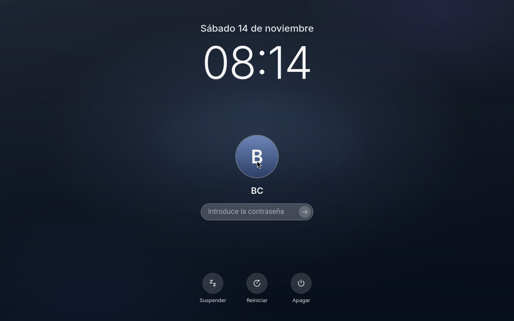
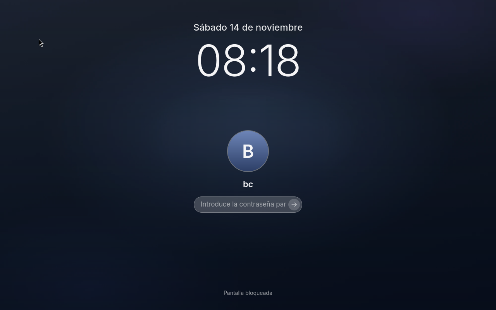

<p align="center">
  
</p>

<h1 align="center">BC OS</h1>

<p align="center"><b>LIGERO. POTENTE. FLUIDO.</b><br>
Sistema operativo Linux ARM64 creado por <b>Borja Candel</b>, en español por defecto.</p>

<p align="center">
  
  
  
  
  
</p>

<p align="center">
  
  <br><sub>Captura real de BC OS 0.2.0-alpha en QEMU aarch64: BC Shell sobre labwc (Wayland), render por software, estado real de red y sonido.</sub>
</p>

> **Estado honesto:** alpha. `0.2.0-alpha` ya es un escritorio funcional (login, bloqueo, Archivos con Papelera, Monitor, Configuración, Tienda, notificaciones…), verificado en QEMU aarch64; **las versiones 0.1.2 y 0.1.3 arrancaron en VirtualBox ARM64, la 0.2.0 aún no se ha probado ahí**. **No hay ISO todavía** (el instalador `bc-install` va dentro de la imagen). Ver [problemas conocidos](#problemas-conocidos).

---

## Descargar y probar

Última imagen: [**Releases**](https://github.com/borjacandeel/BC-OS/releases) (prerelease). Cada release incluye `BC-OS-<versión>-ARM64.vdi.zip` y `SHA256SUMS`.

1. Descomprime el `.zip` → `.vdi`. Comprueba `shasum -a 256`.
2. VirtualBox (Mac Apple Silicon) → **Nueva**: Linux / Arch Linux (ARM 64-bit), ≥ 2 GB RAM, 2 CPU.
3. **Sistema → Habilitar EFI**. Disco: usar el `.vdi` existente. Gráficos: VMSVGA.
4. Arranca: menú de 5 s (animación de arranque por defecto o modo seguro) → **panel de login**. Usuario `bc`, contraseña `bcos` (**solo alpha**).

También se prueba sin VirtualBox con QEMU (`qemu-system-aarch64 -M virt` + UEFI AAVMF); ver [`docs/development/BUILD.md`](docs/development/BUILD.md).

## Versiones

| Versión | Estado | Qué trae |
|---|---|---|
| `0.1.0-alpha` | publicada | Primera imagen ARM64: arranca en QEMU; en VirtualBox falla el `fsck` del root (ver abajo). |
| `0.1.1-alpha` | publicada | Mitigación del `fsck`; en VirtualBox arrancaba a pantalla negra (labwc sin 3D). |
| `0.1.2-alpha` | publicada | **Arranca en VirtualBox ARM64** con BC Shell (render por software) y SSH activado. El shell es una maqueta. |
| `0.1.3-alpha` | publicada | Shell con Dock y Archivos reales, iconos BC, fondo BC, instalador `bc-install` y animación de arranque con el logo. **Arranca en VirtualBox ARM64, también con la animación (confirmado por el creador).** |
| `0.2.0-alpha` | publicada | **Escritorio funcional**: login (greetd), bloqueo, apagado, Centro de control real, notificaciones, Archivos + Papelera, Monitor, Configuración, Tienda, lanzador, iconos y fondo BC, BC Core y SSH. Verificada en QEMU. |
| `0.3.0` → `1.0.0` | planificadas | Ventanas externas en el Dock, bloqueo seguro (`ext-session-lock`), tema claro, ISO con instalador, beta y primera estable. Son hitos, no promesas. |

## Capturas

<table>
  <tr>
    <td width="50%"><br><sub><b>Login</b> (greetd + greeter propio sobre cage): reloj, avatar, contraseña con animación de error y botones de energía.</sub></td>
    <td width="50%"><br><sub><b>Bloqueo</b> (Ctrl+Súper+Q): misma estética, verifica con PAM.</sub></td>
  </tr>
  <tr>
    <td><br><sub><b>Tienda</b> sobre pacman, abierta dentro de la sesión.</sub></td>
    <td><br><sub><b>Arranque</b>: logo BC con barra de progreso (Plymouth).</sub></td>
  </tr>
  <tr>
    <td><br><sub><b>Pack de iconos BC</b> (catálogo).</sub></td>
    <td><br><sub><b>Referencia visual</b> del creador: el objetivo de diseño, no una captura del sistema.</sub></td>
  </tr>
</table>

## Problemas conocidos

- **VirtualBox:** `0.1.0` y `0.1.1` fallaban (`fsck`; labwc sin 3D). `0.1.2`/`0.1.3` arrancan con render por software. **`0.2.0-alpha` aún no se ha probado en VirtualBox** (sí en QEMU).
- Las ventanas externas (Terminal, Firefox) no se minimizan/restauran desde el Dock: falta `wlrctl` en los repositorios.
- El **bloqueo** es una superposición, no usa `ext-session-lock-v1`: otra ventana podría recibir teclado. Pendiente.
- Contraseña por defecto pública (`bc` / `bcos`) y SSH activo: solo para pruebas en máquinas virtuales.
- Sin tema claro, sin app de Música, sin ISO. Wi-Fi y Bluetooth sin probar con hardware real.
- Rendimiento no medido con rigor; observado: ~250 MB de RAM usados tras iniciar sesión (QEMU, 2 GB).

---

## Qué es BC OS

Un Linux ARM64 **ligero, fluido y en español**, con un escritorio propio (**BC Shell**) de estética minimal inspirada en macOS pero con identidad original (logos en [`assets/branding/`](assets/branding/)). No usa código, marcas ni recursos de Apple.

| Pieza | Elección |
|---|---|
| Base | Arch Linux ARM (aarch64), kernel Linux estándar, systemd, pacman |
| Gráficos | Wayland · compositor **labwc** (wlroots) · Mesa; respaldo por software |
| Shell | **BC Shell**: Qt 6 / QML |
| Servicios | **BC Core**: Rust + D-Bus (`bc-daemon`, settings, update, security, hardware, performance) |
| Sistema | PipeWire · NetworkManager · zram · nftables · arranque UEFI con systemd-boot |
| Idioma | `es_ES` por defecto, inglés secundario (Qt Linguist) |
| Imagen | GPT: ESP FAT32 + ext4, construida en CI ARM64 nativo |

Decisiones y motivos: [`ARCHITECTURE.md`](ARCHITECTURE.md) y [`docs/adr/`](docs/adr/).

## Estado por componente

| Componente | Estado |
|---|---|
| Imagen ARM64 (UEFI, systemd-boot, animación de arranque) | ✅ QEMU · ✅ VirtualBox (0.1.2/0.1.3) · 🟡 0.2.0 sin probar en VirtualBox |
| Login (greetd + greeter QML), bloqueo, apagado/reinicio/suspender/cerrar sesión | ✅ verificado en QEMU (incluye respaldo de autologin) |
| BC Shell: barra, Dock, Centro de control, notificaciones, lanzador | ✅ estado real (audio, red, batería, brillo, Bluetooth, No molestar) |
| Archivos (nueva carpeta, renombrar, Papelera) · Monitor · Configuración · Tienda | ✅ funcionales; Tienda usa `sudo` con tu contraseña |
| BC Core (6 servicios D-Bus de usuario) | ✅ construidos e instalados; arrancan con la sesión |
| Pack de iconos BC (186) integrado en el shell e instalado como tema | ✅ |
| Instalador (`bc-install`) | 🟡 probado en QEMU (con y sin LUKS); dentro de la imagen |
| ISO con instalador | ⛔ pendiente |
| Ventanas externas en el Dock, bloqueo seguro, tema claro, Música | ⛔ pendiente |
| Benchmarks / optimización | 🟡 primeras medidas; sin rigor |

## Objetivos (a medir, no garantizados)

RAM en reposo ≤ 700 MB · CPU en reposo ≈ ≤ 2 % · 60 FPS (120 donde se pueda) · arranque rápido. Se medirán sobre una VM de referencia documentada antes de afirmar nada.

## Hoja de ruta

`0` Viabilidad ✅ → `1` Base ✅ (arranca) → `2` BC Shell 🟡 → `3` Identidad visual 🟡 → `4` Apps → `5` Integración → `6` Optimización → `7` Instalador → `8` Beta pública. Detalle en [`ROADMAP.md`](ROADMAP.md) y trabajo vivo en [`PENDIENTE.md`](PENDIENTE.md).

## Estructura del repositorio

```
assets/branding/    logos e iconos oficiales BC
build/              pipeline de imagen (build-all, mkimage, rootfs, overlay)
core/               BC Core (Rust)
shell/              BC Shell (Qt 6 / QML)
icons/              pack de iconos (SPEC, fuentes SVG, build, lint, catálogo)
docs/               diseño, desarrollo, ADRs, capturas
tools/              diagnóstico de host, utilidades
.github/workflows/  CI en runners ARM64 (ci.yml, image.yml)
```

## Construir

```bash
sudo build/build-all.sh 0.1.1-alpha      # imagen completa (host ARM64 o x86_64 con qemu-user)
```

En GitHub: **Actions → Imagen ARM64 → Run workflow** (opción *publicar* crea un prerelease). Guía completa: [`docs/development/BUILD.md`](docs/development/BUILD.md), pruebas: [`TESTING.md`](docs/development/TESTING.md), ARM64/VirtualBox: [`ARM64.md`](docs/development/ARM64.md).

## Principios

Español primero · solo ARM64 · nada de afirmar lo no probado · seguridad intacta · optimizar midiendo · builds reproducibles · sin credenciales en el repo. Normas en [`CONTRIBUTING.md`](CONTRIBUTING.md) y [`SECURITY.md`](SECURITY.md). Reglas para agentes: [`CLAUDE.md`](CLAUDE.md).

---

<p align="center">© Borja Candel · Licencia GPL-3.0-or-later con marca y logos reservados (ver <a href="LICENSE"><code>LICENSE</code></a>)</p>
